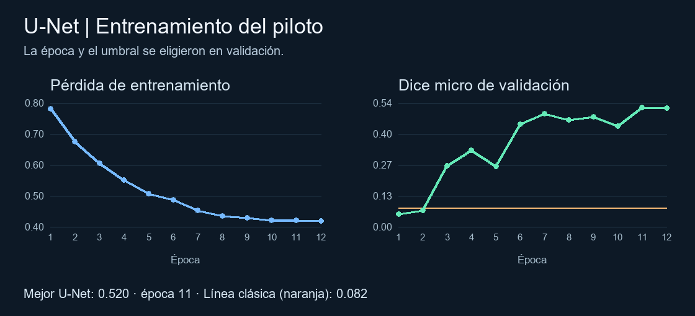

# Segmentación de miotubos en imágenes de microscopía

Hector, Elisheba y Mateo · Reto Miotubos 2026

La U-Net superó a la línea clásica en la prueba reservada de 42 imágenes, con Dice de **0.371 frente a 0.055**. La misma red procesó las 3,113 imágenes de `subset_10GB` en **117.85 s**. El resultado demuestra una mejora sobre la referencia clásica para este piloto. La variación entre grupos y la precisión de 26.7 % indican que todavía hace falta revisar el desempeño antes de usar las máscaras como mediciones.

## Datos y método

Se revisaron las 306 parejas imagen–máscara de `vt`. El piloto apartó 23 archivos de fotos idénticas con máscaras en conflicto y tres rectángulos de cobertura extrema. Con semilla 2026 se agruparon las 280 parejas restantes por identificadores del nombre y se asignaron 196 a entrenamiento, 42 a validación y 42 a prueba. Las 35 imágenes sin identificador reconocible quedaron juntas en entrenamiento. Se conservaron 34 máscaras vacías con estado pendiente de confirmación.

La línea clásica se eligió entre 16 variantes. Usa contraste local, Otsu × 0.9 y operaciones morfológicas. La U-Net de 271,693 parámetros se entrenó por 12 épocas con recortes, volteos, AdamW y BCE ponderada combinada con pérdida Dice. Se seleccionaron la época 11 y el umbral 0.80 en validación. Ambos métodos predicen a 648 × 486. Las métricas se comparan contra las referencias a 2592 × 1944.

## Resultados en prueba reservada

| Métrica micro | Línea clásica | U-Net |
|---|---:|---:|
| Dice | 0.055 | 0.371 |
| IoU | 0.028 | 0.228 |
| Precisión | 3.2 % | 26.7 % |
| Sensibilidad | 19.5 % | 61.0 % |

La U-Net recuperó varios tramos que la referencia clásica confundía con bordes y manchas. En el peor caso visual, la red marcó estructuras alargadas, pero ninguna coincidió con los dos tramos anotados. Dos de las cinco imágenes con máscara vacía tuvieron detecciones de la U-Net. La red mejoró en los cinco grupos con píxeles anotados. Su Dice varió entre 0.089 y 0.602 por grupo, y bajó de 0.520 en validación a 0.371 en prueba.

## Prueba de escala y limitaciones

La RTX 3050 Laptop procesó los 3,113 PNG en lotes de cuatro, incluyendo lectura, reducción, inferencia y escritura de máscaras. Se obtuvieron **26.42 imágenes/s** y un ZIP de 1.62 MB con una máscara por archivo. La revisión visual detectó al menos una predicción sobre el borde curvo del campo. El conjunto carece de referencias para medir Dice o IoU.

Para la entrega también se [exportaron las máscaras a 2592 × 1944](06-prueba-escala.md#máscaras-al-tamaño-de-la-imagen-original) mediante vecino más cercano. Esta exportación conserva las detecciones y se ejecuta por separado de la corrida cronometrada.

Los identificadores de `vt` permitieron impedir que un mismo grupo por nombre se repartiera entre entrenamiento y prueba. Queda por verificar si distintos grupos comparten placa, pozo o muestra. También falta confirmar si las máscaras vacías son negativos revisados y si los tramos anotados cubren todos los miotubos relevantes. El siguiente trabajo sería aclarar esas preguntas y preparar una prueba etiquetada que represente los bordes del campo y otras condiciones de captura.

## Evidencia y reproducción

- [01. Auditoría de datos](01-auditoria-datos.md) y [02. Partición del piloto](02-particion-piloto.md).
- [03. Línea base clásica](03-linea-base.md) y [04. Entrenamiento de la U-Net](04-unet-piloto.md).
- [05. Prueba reservada, con generación del panel cualitativo](05-comparacion-prueba.md) y [06. Prueba de escala](06-prueba-escala.md).
- Los archivos de `experimentos/` guardan métricas, parámetros y recuentos. Los pasos se reproducen con los datos locales de `vt`, `subset_10GB` y las instrucciones del [README](../README.md).

Fuente del planteamiento y criterios de evaluación: *MyotubesAug_2026.pdf*, pp. 1-5. Fuentes de los resultados: ejecución del código con el conjunto `vt` y el manifiesto de `subset_10GB`.
